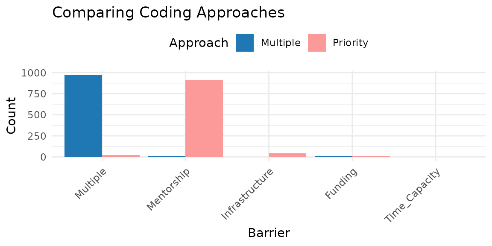
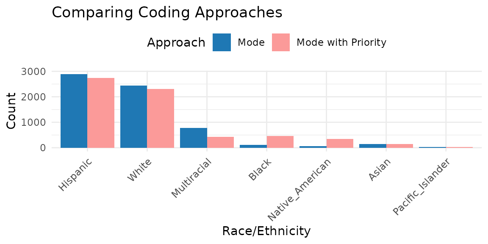

# CATAcode Overview

## Introduction to `CATAcode`

Check-all-that-apply (CATA) items present numerous methodological
challenges that can hinder the validity of survey research. In
particular, accurately measuring, reporting, interpreting, and
evaluating participants’ identities is essential.

`CATAcode` is an R package designed to assist researchers in exploring
CATA responses for summary descriptives and and preparing CATA items for
statistical modeling. Applying this tool to cross-sectional and
longitudinal data can help enhance the generalizability, transparency,
and reproducibility of your research.

In surveys, a CATA item can also be structured as a series of forced
choice dichotomous items (e.g., Yes/No). For instance, for an evaluation
of their program graduate students were asked, *“Have you experienced
any of these barriers to conducting research?”*, with 5 options of: lack
of funding, lack of mentorship, lack of research infrastructure (e.g.,
software), lack of time capacity, and other barriers. The survey could
either instruct responses to CATA or to explicitly select Yes or No to
each option. The `CATAcode` package is suitable for analyzing data from
both CATA and forced choice formats.

This vignette demonstrates how to use the `CATAcode` package to:

- Identify participants who endorse multiple categories
- Generate tables showing every endorsement combination in the data
- Apply various strategies for merging and prioritizing categories
- Handle both cross-sectional and longitudinal data

## The `CATAcode` Workflow

1.  Import & wrangle raw wider format data into longer format using the
    cata_prep() function.
2.  Explore all response combinations or category counts to understand
    complexity.
3.  Code new variables with principled strategies (multiple, priority,
    mode).
4.  Document & export metadata, tables, and optional visualizations.

### 1. Import and Wrangle Data

You can install the released version of `CATAcode` from CRAN with:

``` r

install.packages("CATAcode")
```

Or the development version from GitHub:

``` r

devtools::install_github("knickodem/CATAcode")
```

Once installed, load the package:

``` r

library(CATAcode)
```

#### Data Preparation

Before using the main
[`cata_code()`](https://knickodem.github.io/CATAcode/reference/cata_code.md)
function, the data must be prepared. The
[`cata_prep()`](https://knickodem.github.io/CATAcode/reference/cata_prep.md)
function helps reshape your data from wider to longer format.

**Requirements**

Your dataset should include:

- An ID variable
- A set of variables (i.e., columns) indicating the check-all-that-apply
  categories to examine. All variables are expected to be dichotomous
  (e.g., 1/0, Yes/No, TRUE/FALSE) where the value signifying endorsement
  is consistent across all of the variables.
- For longitudinal data, a time variable (e.g., Wave)

**Example Data**

The `CATAcode` package includes a longitudinal dataset comprised of CATA
responses to 7 race/ethnicity identities from 6,442 students at four
time points. For each identity category/column, 1 = Selected and `NA` =
Not selected. To load and view the first few rows of the dataset:

``` r

data("sources_race")
head(sources_race)
#> # A tibble: 6 × 9
#>   ID     Wave Black Native_American Asian Hispanic Multiracial Pacific_Islander
#>   <chr> <dbl> <dbl>           <dbl> <dbl>    <dbl>       <dbl>            <dbl>
#> 1 10002     1    NA              NA    NA        1          NA               NA
#> 2 10005     1    NA              NA    NA        1          NA               NA
#> 3 10006     1    NA              NA    NA        1          NA               NA
#> 4 10007     1    NA              NA    NA        1          NA               NA
#> 5 10009     1    NA              NA    NA        1          NA               NA
#> 6 10010     1    NA              NA    NA       NA          NA               NA
#> # ℹ 1 more variable: White <dbl>
```

Let’s also create some example cross-sectional (i.e., single timepoint)
data based on our earlier question to graduate students: “Have you
experienced any of these barriers to conducting research?” For each
category, students provide a “Yes” or “No” response.

``` r


# Creating a cross-sectional dataset (N = 1000)
set.seed(123)  

n_cross = 1000

cross = data.frame(
  ID               = 1:n_cross,
  Funding          = sample(c("No", "Yes"), n_cross, replace = TRUE, prob = c(.15, .85)),
  Mentorship       = sample(c("No", "Yes"), n_cross, replace = TRUE, prob = c(.10, .90)),
  Infrastructure   = sample(c("No", "Yes"), n_cross, replace = TRUE, prob = c(.45, .55)),
  Time_Capacity    = sample(c("No", "Yes"), n_cross, replace = TRUE, prob = c(.25, .75)),
  Other_Barrier    = sample(c("No", "Yes"), n_cross, replace = TRUE, prob = c(.80, .20))
  )

# Display the first few rows of the dataset
head(cross)
#>   ID Funding Mentorship Infrastructure Time_Capacity Other_Barrier
#> 1  1     Yes        Yes            Yes           Yes            No
#> 2  2     Yes        Yes            Yes            No           Yes
#> 3  3     Yes        Yes            Yes           Yes            No
#> 4  4      No        Yes            Yes           Yes           Yes
#> 5  5      No        Yes            Yes           Yes            No
#> 6  6     Yes        Yes             No           Yes            No
```

**Using cata_prep**

[`cata_prep()`](https://knickodem.github.io/CATAcode/reference/cata_prep.md)
is the gateway function for every workflow in
[`cata_code()`](https://knickodem.github.io/CATAcode/reference/cata_code.md).

Its jobs are to:

1.  **Reshape** data from wide to tidy‑long format so the downstream
    [`cata_code()`](https://knickodem.github.io/CATAcode/reference/cata_code.md)
    function can iterate over one row per person‑category (or
    person‑time‑category).
2.  **Standardize** column names (`id`, `Category`, `Response`, `time`)
    and stores them as attributes, eliminating repetitive arguments. You
    tell
    [`cata_prep()`](https://knickodem.github.io/CATAcode/reference/cata_prep.md)
    which columns hold the IDs, which columns hold the categories, and
    how you want to name the two columns in the long format data that
    contain the categories and endorsed/not endorsed responses.

**[`cata_prep()`](https://knickodem.github.io/CATAcode/reference/cata_prep.md)
function arguments:**

- data = cross
  - Provide the name of the dataset. In our case *cross* for the
    cross-sectional dataset.
- id = ID
  - Supply the column that uniquely identifies each respondent. Must be
    unique *within each time‑point* if you also pass `time =`.
  - If your ID column is named something else, e.g. “participant_id”,
    write id = participant_id.
- cols = Funding:Other_Barrier
  - Tell
    [`cata_prep()`](https://knickodem.github.io/CATAcode/reference/cata_prep.md)
    which columns are the dichotomous CATA indicators. In the
    cross-sectional data, these are the barriers; in the longitudinal
    data, these are the race/ethnicity identities.
  - You can:
    - Use the tidy‑select range syntax we show here, which grabs every
      column from `Funding` through `Other_Barrier`, inclusive, in the
      order they appear in the data frame.
    - List them explicitly: cols = c(Black, Native_American, Asian,
      White, Pacific_Islander, Hispanic, Multiracial)
    - Or use a tidy‑select helper when applicable: cols =
      starts_with(“race\_”)
- names_to = “Barriers” and values_to = “YN”
  - When
    [`cata_prep()`](https://knickodem.github.io/CATAcode/reference/cata_prep.md)
    transforms the data into long format it needs to name the resulting
    two columns storing the cateogry labels and participants’ responses
    to each category, respectively. You have the option of providing the
    names using the `names_to` argument for the categories and
    `values_to` argument for the responses. By default,
    [`cata_prep()`](https://knickodem.github.io/CATAcode/reference/cata_prep.md)
    uses the names “Categories” and “Responses”, respectively.
- time = Wave
  - For longitudinal data, provide the column indicating the time so
    [`cata_prep()`](https://knickodem.github.io/CATAcode/reference/cata_prep.md)
    keeps observations from different time points separate.

***After this call, the new data will be a tidy long dataframe with
three or four standardized columns: id, Category, Response, and time (if
supplied).***

``` r

# Prepare cross-sectional 
datacross_prep <- cata_prep(data = cross, id = ID, cols = Funding:Other_Barrier, names_to = "Barriers", values_to = "YN")

# Prepare longitudinal 
datalong_prep <- cata_prep(data = sources_race, id = ID, cols = c(Asian, Black:White), time = Wave)

# Display the first few rows of the prepared data
head(datacross_prep)
#> # A tibble: 6 × 3
#>      ID Barriers       YN   
#>   <int> <chr>          <chr>
#> 1     1 Funding        Yes  
#> 2     1 Mentorship     Yes  
#> 3     1 Infrastructure Yes  
#> 4     1 Time_Capacity  Yes  
#> 5     1 Other_Barrier  No   
#> 6     2 Funding        Yes
head(datalong_prep)
#> # A tibble: 6 × 4
#>   ID     Wave Category         Response
#>   <chr> <dbl> <chr>               <dbl>
#> 1 10002     1 Asian                  NA
#> 2 10002     1 Black                  NA
#> 3 10002     1 Native_American        NA
#> 4 10002     1 Hispanic                1
#> 5 10002     1 Multiracial            NA
#> 6 10002     1 Pacific_Islander       NA
```

### 2. Explore All Response Combinations

The first step when analyzing CATA data is exploring all combinations of
categories present in the data. The
[`cata_code()`](https://knickodem.github.io/CATAcode/reference/cata_code.md)
function with `approach = "all"` helps identify every unique category
combination. For longitudinal data, `approach = "counts"` provides a
summary of how many times each participant endorsed each category across
time.

**[`cata_code()`](https://knickodem.github.io/CATAcode/reference/cata_code.md)
function arguments:**

- data = datacross_prep (or datalong_prep)
  - The tidy‑long format dataframe returned by
    [`cata_prep()`](https://knickodem.github.io/CATAcode/reference/cata_prep.md).
- id = ID
  - Column that uniquely identifies each respondent. Must match the `id`
    we specified in
    [`cata_prep()`](https://knickodem.github.io/CATAcode/reference/cata_prep.md),
    which was `ID` for both the cross-sectional and longitudinal
    datasets.
- categ = Barriers
  - The column that stores the category labels. For the cross-sectional
    data, we named this column “Barriers” in
    [`cata_prep()`](https://knickodem.github.io/CATAcode/reference/cata_prep.md).
    For the longitudinal data, we relied on the
    [`cata_prep()`](https://knickodem.github.io/CATAcode/reference/cata_prep.md)
    default name of “Category”.
- resp = YN
  - The column that stores the response codes (e.g., Yes/No). For the
    cross-sectional data, we named this column “YN” in
    [`cata_prep()`](https://knickodem.github.io/CATAcode/reference/cata_prep.md).
    For the longitudinal data, we relied on the
    [`cata_prep()`](https://knickodem.github.io/CATAcode/reference/cata_prep.md)
    default name of “Response”.
- approach = “all”
  - “all” will return **every unique combination** of endorsed
    categories for each person‑wave. Useful for an initial scan of
    response complexity.
  - “counts” is only for longitudinal data, which we show below, and
    returns a **count table** of how many times each participant
    endorsed each category across time points.
  - We will discuss the other options of “multiple”, “priority”, and
    “mode” in a moment.
- endorse = “Yes”
  - The value in `resp` indicating endorsement of the category. For the
    cross-sectional data, the value is “Yes”; in the longitudinal data,
    the value is 1.
- new.name = (optional)
  - Name for the newly created variable when `approach` = “all”,
    “multiple”, “priority”, or “mode”. For “counts” a wide
    participant‑level dat frame is returned, so `new.name` is ignored.
- sep = “-”
  - Only used for `approach = "all"` to separate each endorsed category
    when they are combined into a single variable.

**Explore all combinations in cross-sectional data**

``` r

# Explore all combinations in cross-sectional data
cross_all <- cata_code(data = datacross_prep,
                      id = ID,
                      categ = Barriers,
                      resp = YN,
                      approach = "all",
                      endorse = "Yes",
                      new.name = "Combinations",
                      sep = "-")

# Display the result
head(cross_all)
#> # A tibble: 6 × 2
#>      ID Combinations                                         
#>   <int> <chr>                                                
#> 1     1 Funding-Mentorship-Infrastructure-Time_Capacity      
#> 2     2 Funding-Mentorship-Infrastructure-Other_Barrier      
#> 3     3 Funding-Mentorship-Infrastructure-Time_Capacity      
#> 4     4 Mentorship-Infrastructure-Time_Capacity-Other_Barrier
#> 5     5 Mentorship-Infrastructure-Time_Capacity              
#> 6     6 Funding-Mentorship-Time_Capacity
# 
# Count the frequency of each combination
table(cross_all$Combinations)
#> 
#>                                                       Funding 
#>                                                            12 
#>                                        Funding-Infrastructure 
#>                                                            11 
#>                          Funding-Infrastructure-Other_Barrier 
#>                                                             1 
#>                          Funding-Infrastructure-Time_Capacity 
#>                                                            18 
#>            Funding-Infrastructure-Time_Capacity-Other_Barrier 
#>                                                             5 
#>                                            Funding-Mentorship 
#>                                                            72 
#>                             Funding-Mentorship-Infrastructure 
#>                                                            97 
#>               Funding-Mentorship-Infrastructure-Other_Barrier 
#>                                                            27 
#>               Funding-Mentorship-Infrastructure-Time_Capacity 
#>                                                           259 
#> Funding-Mentorship-Infrastructure-Time_Capacity-Other_Barrier 
#>                                                            57 
#>                              Funding-Mentorship-Other_Barrier 
#>                                                             7 
#>                              Funding-Mentorship-Time_Capacity 
#>                                                           213 
#>                Funding-Mentorship-Time_Capacity-Other_Barrier 
#>                                                            51 
#>                                         Funding-Other_Barrier 
#>                                                             1 
#>                                         Funding-Time_Capacity 
#>                                                            20 
#>                           Funding-Time_Capacity-Other_Barrier 
#>                                                             2 
#>                                                Infrastructure 
#>                                                             3 
#>                                  Infrastructure-Other_Barrier 
#>                                                             1 
#>                                  Infrastructure-Time_Capacity 
#>                                                             5 
#>                                                    Mentorship 
#>                                                            12 
#>                                     Mentorship-Infrastructure 
#>                                                            13 
#>                       Mentorship-Infrastructure-Other_Barrier 
#>                                                             5 
#>                       Mentorship-Infrastructure-Time_Capacity 
#>                                                            34 
#>         Mentorship-Infrastructure-Time_Capacity-Other_Barrier 
#>                                                             6 
#>                                      Mentorship-Time_Capacity 
#>                                                            53 
#>                        Mentorship-Time_Capacity-Other_Barrier 
#>                                                             9 
#>                                                 Time_Capacity 
#>                                                             4 
#>                                   Time_Capacity-Other_Barrier 
#>                                                             1
```

**Explore endorsement counts over time in longitudinal data**

``` r

# Explore all combinations in cross-sectional data
# Get counts across waves
long_counts <- cata_code(data = datalong_prep,
                         id = ID,
                         categ = Category,
                         resp = Response,
                         approach = "counts",
                         endorse = 1)

# Display the result
head(long_counts)
#> # A tibble: 6 × 3
#> # Groups:   ID [5]
#>   ID     Category        n_time
#>   <chr>  <chr>            <int>
#> 1 100003 White                4
#> 2 100006 White                1
#> 3 100009 Asian                1
#> 4 100010 White                2
#> 5 100011 Native_American      2
#> 6 100011 White                1
```

### 3. Coding A New Variable for Statistical Analysis

`CATAcode` offers several approaches with the
[`cata_code()`](https://knickodem.github.io/CATAcode/reference/cata_code.md)
function to prepare CATA data for statistical modeling:

- “multiple” - combine anyone endorsing ≥ 2 categories into a single
  catch‑all group (e.g., “Multiracial”).
- “priority” - assign a participant to the first category in a
  user‑supplied priority list that they endorsed.
- “mode” - longitudinal only; assign the category endorsed most often
  across waves (ties are handled like “multiple” or decided by priority
  if supplied).

**The “multiple” Approach**

The “multiple” approach automatically combines individuals who have
reported **two or more categories** into the same group.

A new argument to name the new category:

- multi.name = “Multiple”
  - What to call the catch‑all group of people who checked 2+ boxes.

``` r

# Apply the "multiple" approach
cross_multiple <- cata_code(data = datacross_prep,
                            id = ID,
                            categ = Barriers,
                            resp = YN,
                            approach = "multiple",
                            endorse = "Yes",
                            new.name = "Barrier",
                            multi.name = "Multiple")

# Display the results
table(cross_multiple$Barrier)
#> 
#>        Funding Infrastructure     Mentorship       Multiple  Time_Capacity 
#>             12              3             12            968              4
```

**The “priority” Approach**

In our example the vast majority of students selected two or more
categories and were combined into the Multiple category. Although this
informs the graduate program that most students experience multiple
barriers to conducting research, it provides little information for
actionable changes. In contrast, the “priority” approach allows us to
**prioritize specific categories** of interest. For instance, the
graduate program might have a particular interest improving mentorship
of graduate researchers and investing in research infrastructure.

A new argument to list the priority categories:

- priority = c(“Mentorship”, “Infrastructure”)
  - Vector of category labels in **descending priority order**. A
    participant is assigned to the first category in this list that they
    endorsed. If they endorsed none of the priority categories, they
    fall back to their single selection (or `multi.name` if they
    endorsed \> 1 non‑priority category).

``` r

# Apply the "priority" approach
cross_priority <- cata_code(data = datacross_prep,
                            id = ID,
                            categ = Barriers,
                            resp = YN,
                            approach = "priority",
                            endorse = "Yes",
                            new.name = "Barrier",
                            multi.name = "Multiple",
                            priority = c("Mentorship", "Infrastructure"))

# Display the results
table(cross_priority$Barrier)
#> 
#>        Funding Infrastructure     Mentorship       Multiple  Time_Capacity 
#>             12             44            915             24              4
```

**The “mode” Approach for Longitudinal Data**

The “mode” approach is designed for longitudinal data, placing
individuals into the category they endorsed most often across time
points.

A new argument to list the name of the wave:

- time = Wave
  - Column identifying measurement occasion.

``` r

# Apply the "mode" approach
long_mode <- cata_code(data = datalong_prep,
                       id = ID,
                       categ = Category,
                       resp = Response,
                       approach = "mode",
                       endorse = 1,
                       time = Wave,
                       new.name = "Race_Ethnicity",
                       multi.name = "Multiracial")

# Display the results
table(long_mode$Race_Ethnicity)
#> 
#>            Asian            Black         Hispanic      Multiracial 
#>              152              110             2882              777 
#>  Native_American Pacific_Islander            White 
#>               65               22             2434
```

**Combining the “mode” and “priority” Approaches for Longitudinal Data**

``` r

# Combining "mode" with "priority"
long_mode_priority <- cata_code(data = datalong_prep,
                                id = ID,
                                categ = Category,
                                resp = Response,
                                approach = "mode",
                                endorse = 1,
                                time = Wave,
                                new.name = "Race_Ethnicity",
                                multi.name = "Multiracial",
                                priority = c("Black", "Native_American"))

# Display the results
table(long_mode_priority$Race_Ethnicity)
#> 
#>            Asian            Black         Hispanic      Multiracial 
#>              146              459             2732              423 
#>  Native_American Pacific_Islander            White 
#>              347               22             2313
```

### 4. Document & Export metadata, tables, and optional visualizations.

In addition to comparing the frequency tables with the
[`table()`](https://rdrr.io/r/base/table.html) function, visualizing the
distribution of categories can help researchers make informed decisions
about coding strategies. The next version of `CATAcode` will include
expanded functionality for creating publication ready tables and
figures.

Let’s compare how the response frequencies change with the multiple
approach and prioritizing mentorship and infrastructure in the
cross-sectional data.

``` r

library(ggplot2)

# Get counts from the coded data frames created earlier
counts_multiple = cross_multiple |>
  count(Barrier, name = "Count") |>
  mutate(Approach = "Multiple")

counts_priority = cross_priority |>
  count(Barrier, name = "Count") |>
  mutate(Approach = "Priority")

# Display in a figure
cross_plot = bind_rows(counts_multiple, counts_priority) |>
  ggplot(aes(x = reorder(Barrier, -Count), y = Count,
             fill = Approach)) +
  geom_col(position = "dodge") +
  scale_fill_manual(values = c(Multiple = "#1F78B4",
                               Priority  = "#FB9A99")) +
  labs(x = "Barrier", y = "Count",
       title = "Comparing Coding Approaches") +
  theme_minimal(base_size = 11) +
  theme(axis.text.x = element_text(angle = 45, hjust = 1),
        legend.position = "top")
cross_plot
```



We can also compare the mode approach and the mode with priority
approach in the longitudinal data.

``` r

library(ggplot2)

# Get counts from the coded data frames created earlier
counts_mode = long_mode|>
  count(Race_Ethnicity, name = "Count") |>
  mutate(Approach = "Mode")

counts_mwp = long_mode_priority |>
  count(Race_Ethnicity, name = "Count") |>
  mutate(Approach = "Mode with Priority")

# Display in a figure
long_plot = bind_rows(counts_mode, counts_mwp) |>
  ggplot(aes(x = reorder(Race_Ethnicity, -Count), y = Count,
             fill = Approach)) +
  geom_col(position = "dodge") +
  scale_fill_manual(values = c(Mode = "#1F78B4",
                               `Mode with Priority`  = "#FB9A99")) +
  labs(x = "Race/Ethnicity", y = "Count",
       title = "Comparing Coding Approaches") +
  theme_minimal(base_size = 11) +
  theme(axis.text.x = element_text(angle = 45, hjust = 1),
        legend.position = "top")
long_plot
```



## Recommendations for Using CATAcode

1.  Start by exploring all combinations using the `"all"` and `"counts"`
    approaches.
2.  Retain as much identity nuance as possible where sample size allows.
3.  Document and justify all subjective decisions for merging or
    prioritizing categories.
4.  Include supplemental tables with all category combinations to
    describe the complete demographic picture.
5.  Choose coding approaches based on research questions and sample
    characteristics.

### When to Use Each Approach

| Approach | Best for | Limitations |
|----|----|----|
| `multiple` | Quickly grouping multi‑identity cases | Obscures data when many participants report multiple identities |
| `priority` | Preserving often‑overlooked identities | Can hide additional endorsed identities |
| `mode` | Longitudinal data where identity fluctuates over time | Can mask short‑term identity changes |

### Conclusion

`CATAcode` provides a structured approach to handling CATA survey items
in a transparent and principled manner. By enhancing the precision and
inclusivity of data, this package supports more robust health and social
science research that better reflects the lived experiences and health
needs of diverse communities. For additional information, see the
package documentation by typing
[`?CATAcode::cata_prep`](https://knickodem.github.io/CATAcode/reference/cata_prep.md)
or
[`?CATAcode::cata_code`](https://knickodem.github.io/CATAcode/reference/cata_code.md)
in your R console.
